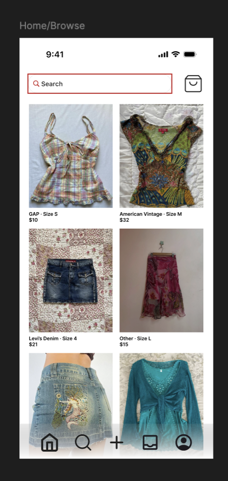
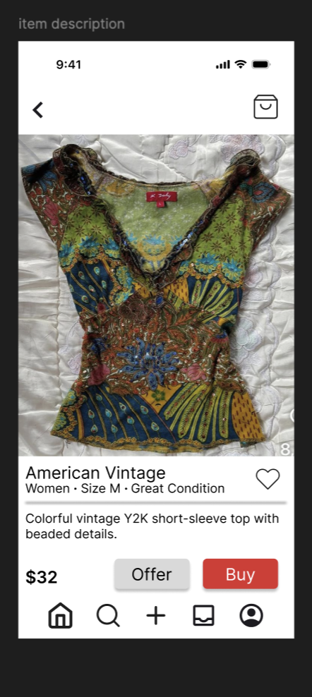
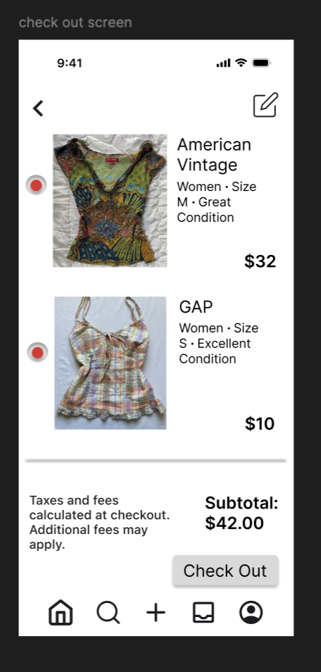

## Interactive Commerce App

## Project Objective: 
Create an interactive mobile shopping interface that uses scrolling and navigation.

## Design Process:
- Learned basic scrolling and interactive navigation flow techniques in Figma.
- Applied visual hierarchy and consistent design patterns for ease of use.
- Developed a high-fidelity prototype to navigate through stages of the shopping experience.

### Home Screen

### Item Details

### Checkout

## Interactive Prototype
[View Interactive Figma Prototype](https://www.figma.com/proto/Jg9XuMDLfzqVeNIY5NYaoy/Esha-Patwardhan?node-id=3-2&p=f&t=Pi73IRO3Jnp3GGXE-1&scaling=scale-down&content-scaling=fixed&page-id=0%3A1&starting-point-node-id=3%3A2)
