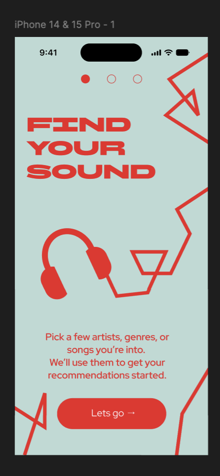
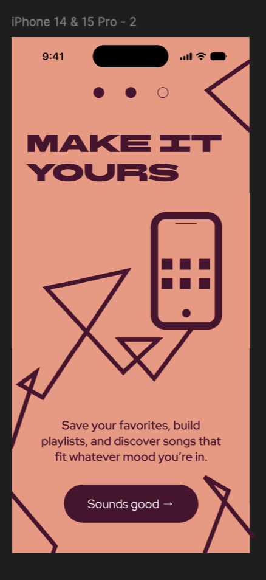
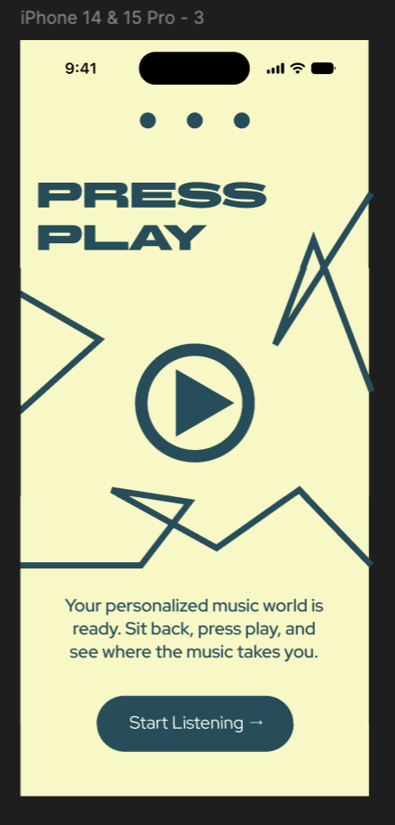

# Music App Onboarding

## Project Objective
Design a three-screen onboarding experience for a music-listening app, focusing on introducing new users to the application through a clear and visually engaging interface.

## Design Approach
- Applied visual hierarchy, typography, and layout principles to guide users through the onboarding experience.
- Focused on creating engaging visuals to keep users interested in the onboarding experience.
- Created a cohesive progression from screen to screen with consistent visual style.

### Onboarding Screen 1

### Onboarding Screen 2

### Onboarding Screen 3

  
