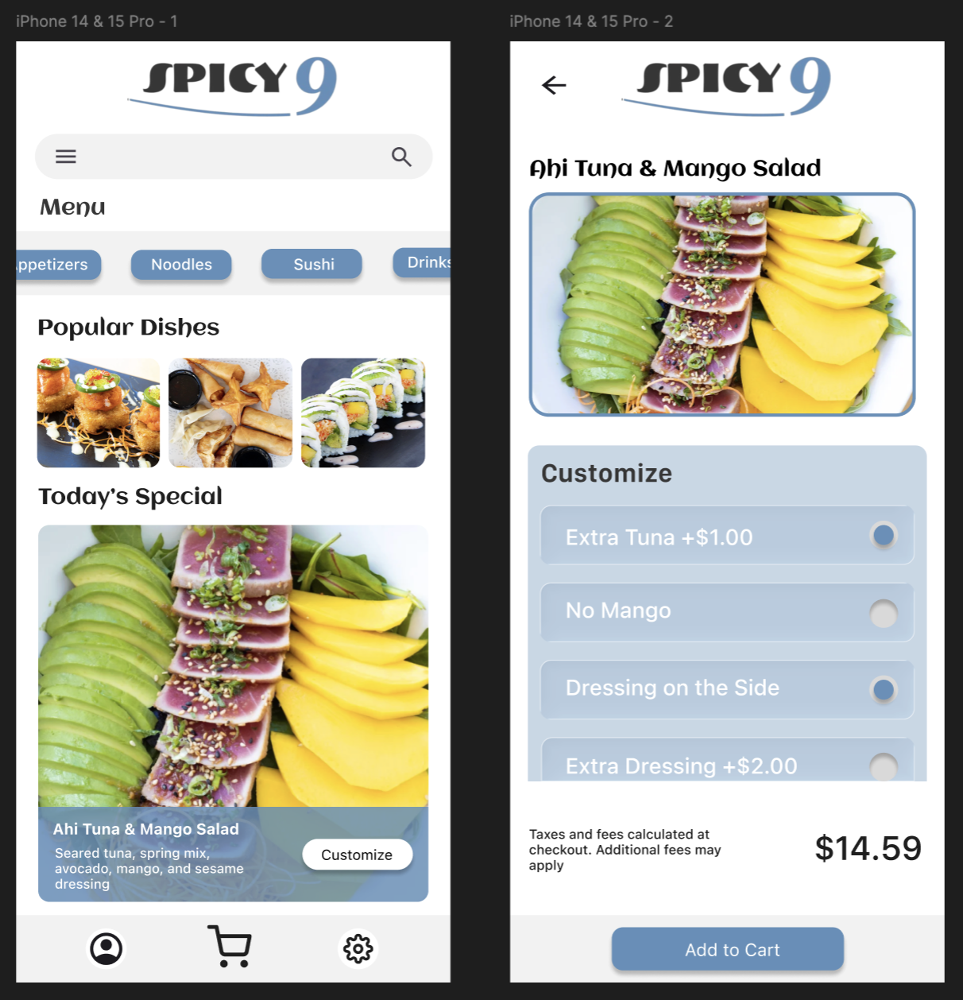

# Restaurant Online Ordering

## Project Overview
Designed two restaurant online ordering interface pages in Figma, exploring how design principles can help create an intuitive digital ordering experience.

## Design Approach
- Explored how different interface layouts can present menu items and other relevant information.
- Focused on spacing and visual hierarchy to make content easy to interact with.
- Focused on creating a cohesive visual design that emphasizes a straightforward ordering experience.

## Final Designs

  
